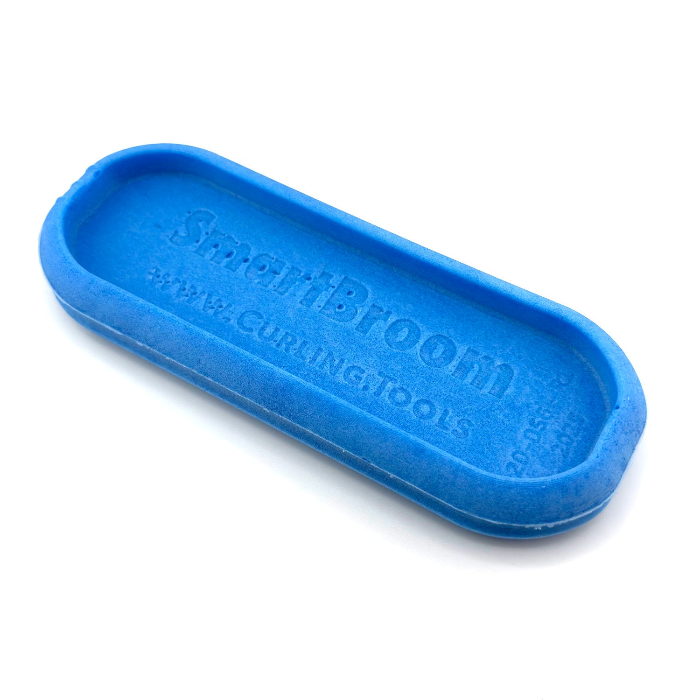

# Checking Your Foam

**BlueFoam 2** is the approved competition foam for SmartBroom 3, SmartBroom 4, and CoreBroom.

## Look for 20-056

Inspect the marking on the foam insert. BlueFoam 2 is marked **20-056**. The photograph below shows the insert and its marked inner face.

{ width="600" }

If you need to remove and refit the sleeve to check the foam, follow [Replacing Sleeves](../replacing-sleeves.md).

Before competition, pair BlueFoam 2 with an [approved broom model](index.md) and a competition sleeve carrying a [valid product code](finding-your-product-code.md).
