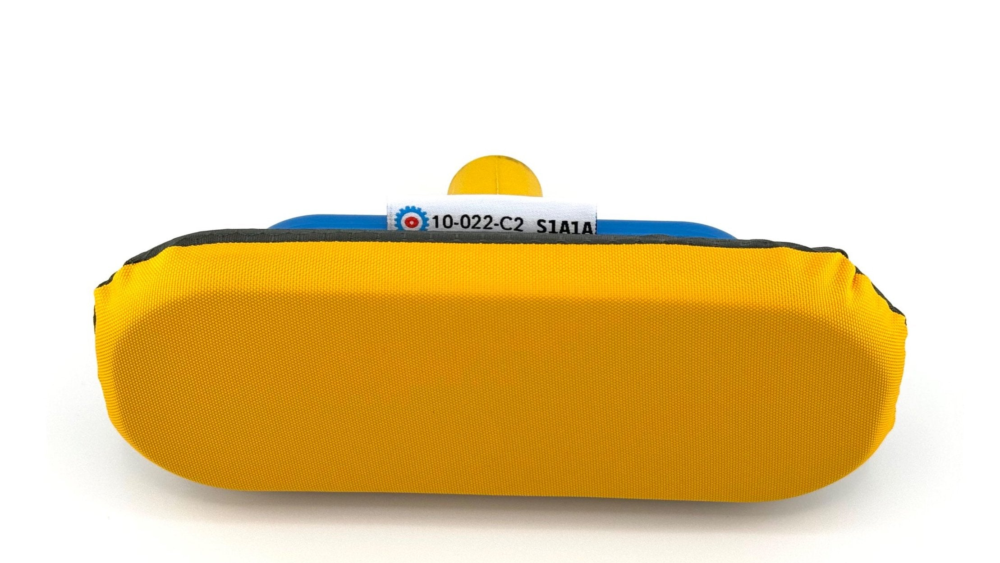

<!-- --8<-- [start:content] -->
# WCF Product Code

The World Curling product code is on the **underside of the label sewn into your competition sleeve**.

Turn the label over to read it. The example below shows **S1A1A**; your sleeve may carry a different valid code as World Curling assigns new approvals.

{ width="680" }

A competition sleeve needs a valid product code to form part of an approved setup. You can check the current approved code list in [World Curling's equipment reference](https://worldcurling.org/brushes/).

The sleeve is one part of the setup. Check [Competition Use](index.md) and [Checking Your Foam](checking-your-foam.md) before competition.

<!-- --8<-- [end:content] -->
