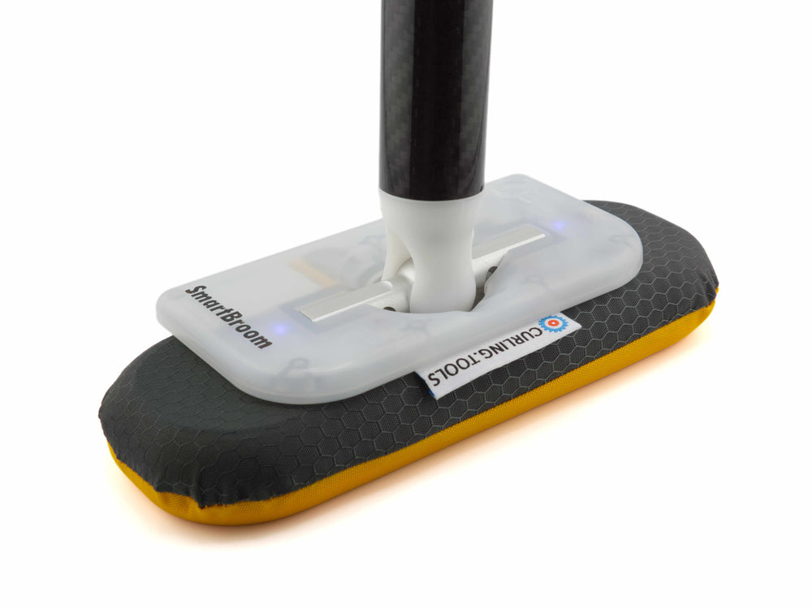
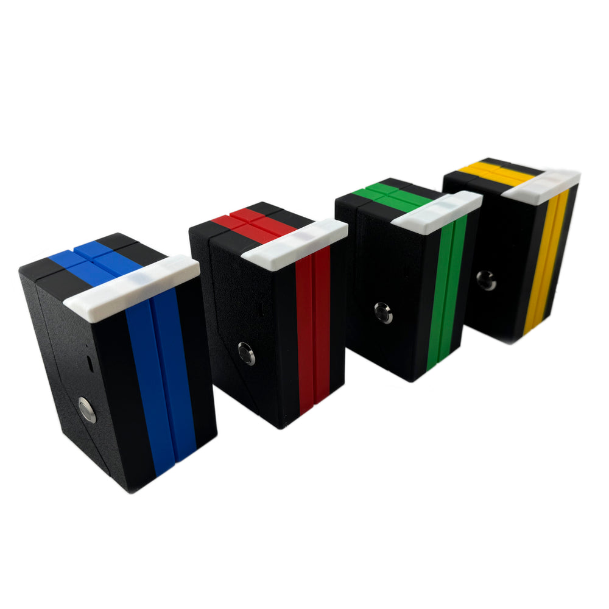
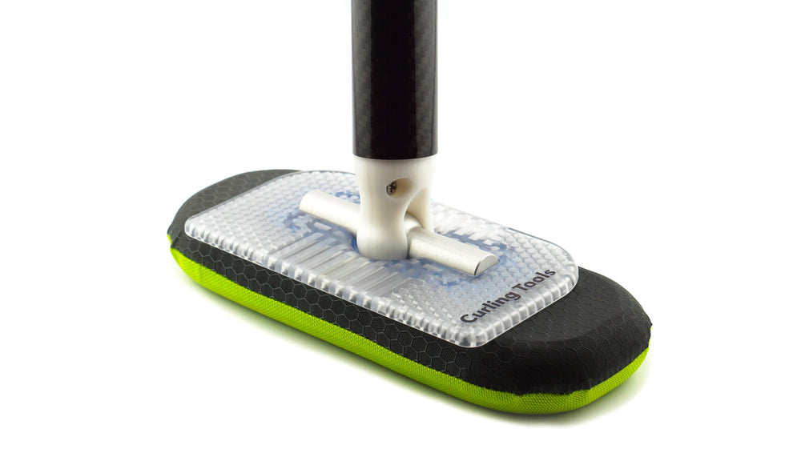
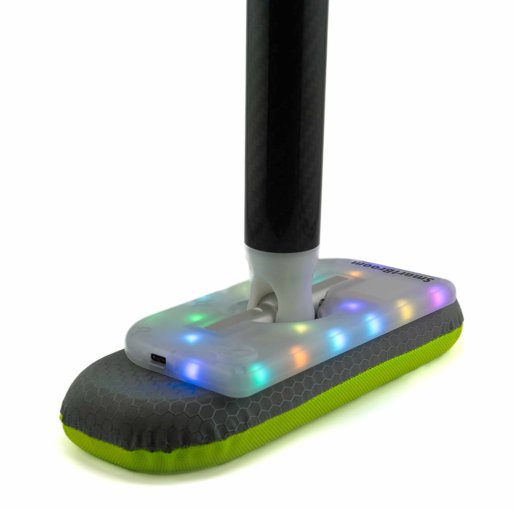
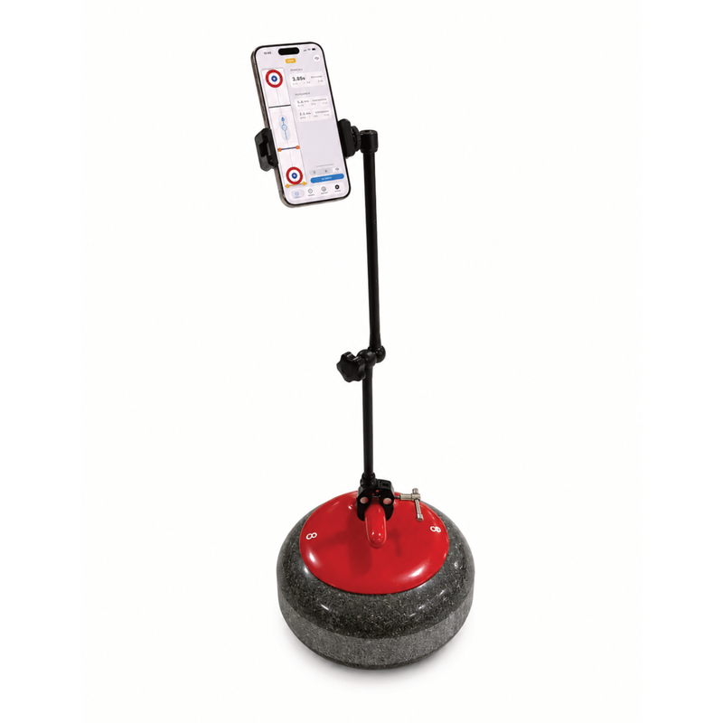

---
hide:
  - navigation
  - toc
  - path
  - footer
---

# Curling Tools Product Guides { .guide-home__eyebrow }

<a class="guide-product" href="smartbroom/getting-started/" aria-labelledby="smartbroom-title">
  

    
  

  

    
PRODUCT GUIDE

    <h2 id="smartbroom-title">SmartBroom 4</h2>
    Explore the product guide →
  

</a>

<a class="guide-product guide-product--beam" href="smartbeam/getting-started/" aria-labelledby="smartbeam-title">
  

    
  

  

    
PRODUCT GUIDE

    <h2 id="smartbeam-title">SmartBeam</h2>
    Explore the product guide →
  

</a>

<a class="guide-product guide-product--secondary" href="corebroom/" aria-labelledby="corebroom-title">
  

    
  

  

    
PRODUCT GUIDE

    <h2 id="corebroom-title">CoreBroom</h2>
    Explore the product guide →
  

</a>

<a class="guide-product guide-product--secondary" href="lightbroom/getting-started/" aria-labelledby="lightbroom-title">
  

    
  

  

    
PRODUCT GUIDE

    <h2 id="lightbroom-title">LightBroom</h2>
    Explore the product guide →
  

</a>

<a class="guide-product guide-product--secondary" href="rockarm/" aria-labelledby="rockarm-title">
  

    
  

  

    
PRODUCT GUIDE

    <h2 id="rockarm-title">RockArm</h2>
    Explore the product guide →
  

</a>

## A little more help?

Get in touch with Curling Tools for questions and technical support.

[Contact us →](contact.md){ .guide-home__support-link }

