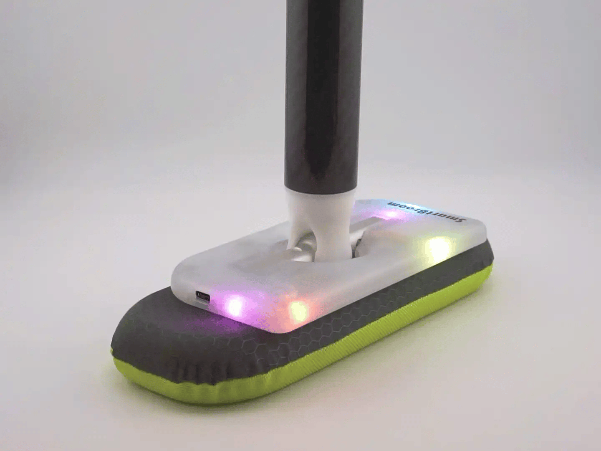

# Using LightBroom

Turn it on, watch the light flow with gravity, then sweep to make it sparkle.

## Turn it on

**Press and release the button.** The broom runs its startup animation, then briefly shows the battery level. After about **2.5 seconds**, the battery display clears and the normal lights begin. A short press dismisses the battery display sooner.

## Let the light flow

**Tilt the broom head.** The light flows with gravity toward the lower side of the head. Change the angle to move the light around the broom.

## Sweep to sparkle

**Put the broom on the ice and sweep.** As you keep sweeping, the lights grow brighter and begin to sparkle. When you slow down or stop, the sparkle fades back to the flowing light.

{ width="600" loading="lazy" }

Choose rainbow for multicoloured lighting, or pick a single colour. See [Choosing Colours](colours-and-effects.md) for the button steps.

## Turn it off

**Hold the button for about 1.5 seconds.** Two red lights briefly indicate shutdown. If you have just been choosing a colour, let the selection display close before holding the button.

LightBroom also switches off after about **one minute of inactivity**. Shake it to wake it after automatic shutoff. If you switched it off with the button, or the battery is below **10%**, use the button to turn it on instead.

See [Charging](charging.md) to read the battery indicators or recharge your broom.
