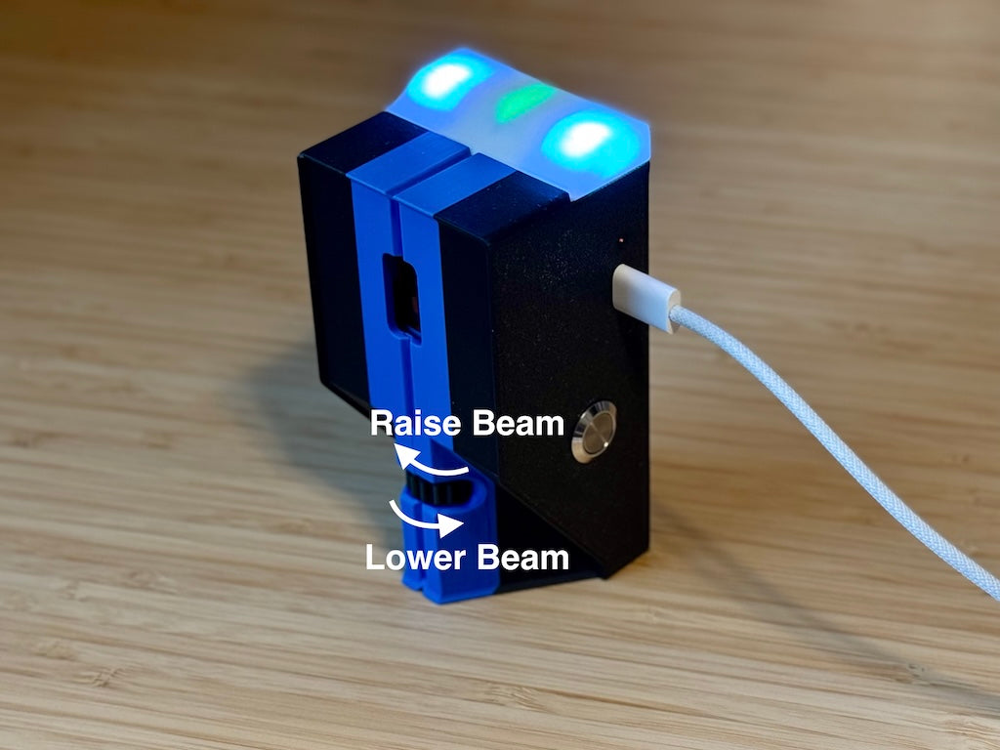

# Beam Alignment

Every SmartBeam is aligned at the factory to aim at the centre of its reflector. If you need to change the beam's height, use the rotary dial on the front of the sensor.

## Adjust the beam height

With the sensor aimed toward the reflector, turn the dial in small increments. **Viewed from above:**

- Turn **clockwise** to raise the beam.
- Turn **anticlockwise** to lower the beam.

{ width="600" }

Check the arrow-shaped beam-state LED as you adjust. It shows green when the beam is established and red when broken. See [LED Indication](led-indication.md#beam-state-led).

## Find flatter ice

The extreme edges of a sheet are often uneven. If you are having trouble hitting the reflector, move both the SmartBeam sensor and reflector a little toward the centre line to find flatter ice, then check the alignment again.

For choosing measurement locations and matching them in the app, see [Setting up Beams](setting-up-beams.md).

Adapted from [Adjusting SmartBeam Laser Angle](https://curling.tools/blogs/support-articles/adjusting-smartbeam-laser-angle) on curling.tools.
