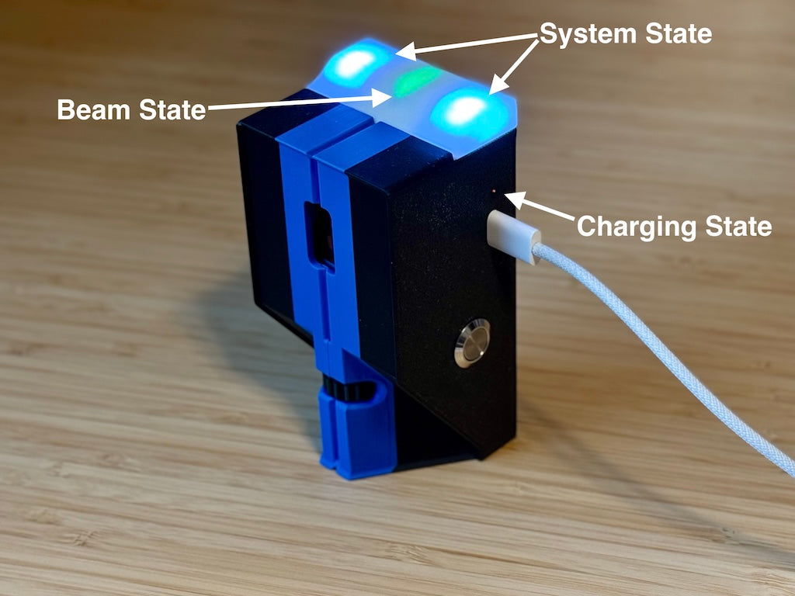

# LED Indication

SmartBeam uses separate LEDs for the beam itself, battery charging, and the timing system state.

## Where to look

- **Beam state:** an arrow-shaped LED pointing down the top of the unit, within the top light-bar.
- **System state:** LEDs at the two ends of the top light-bar.
- **Charging state:** an LED shining through a small hole on the side, directly above the USB port.

## Beam state LED

The arrow-shaped LED always indicates the state of that unit's beam.

| LED colour | Beam state |
| --- | --- |
| Red | Beam broken. |
| Green | Beam established. |

This is separate from the system-state LEDs: the arrow shows the beam state, while the ends of the light-bar show connection and timing states.

## Charging state LED

The LED above the USB port shows orange while charging and green when full. See [Charging](charging.md#read-the-charging-light) for the full indication table and USB power instructions.

## System-state LEDs

The LEDs at the ends of the top light-bar indicate the following states.

### Connection and readiness

| LED indication | Meaning |
| --- | --- |
| Flashing white | Searching for a Bluetooth connection. |
| Solid white | Connected, but not included in the beam setup. |
| Solid yellow | Hot beam: the next expected beam break. |
| Solid blue | Idle and disarmed. |
| Solid purple | Idle and armed. |
| Solid teal | The system will arm when the beam is tripped. |

### Timing and countdowns

| LED indication | Meaning |
| --- | --- |
| Red | Beam broken during timing. |
| Green | Beam complete during timing. |
| Rapid orange flashes | Arming countdown. |
| Blue flashes for about five seconds | Paused countdown. |
| Brief rapid red flashes | Timing cancelled or timed out. |
| Dim purple alternating between the two system-state LEDs | Firmware transfer in progress, on firmware with update-light support. See [Firmware Updates](firmware-updates.md). |

### Identification and low battery

| LED indication | Meaning |
| --- | --- |
| Brief, rapid random-colour pattern | Identifying the device. |
| Red flashes before shutdown | Battery depleted; the unit is about to shut down. |

## Related topics

- [Arming and Timing](arming-and-timing/index.md)
- [Charging](charging.md)
- [Connecting](connecting-smartbeam.md)

