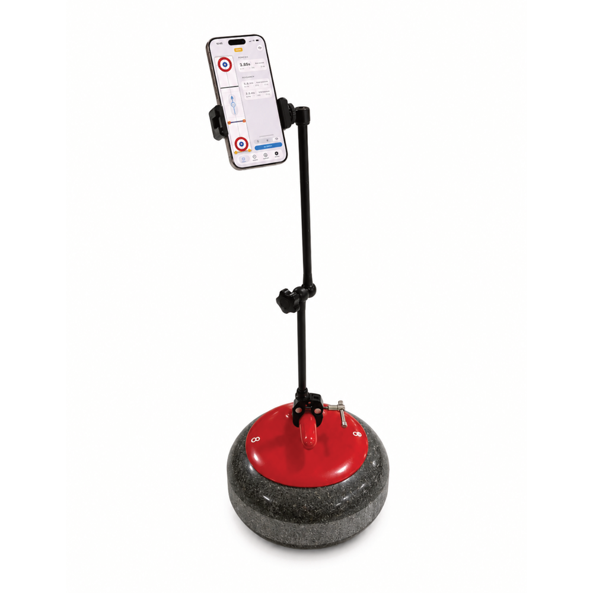

# RockArm

RockArm mounts your phone upright on a curling rock handle so you can view SmartBeam timing results during practice.

{ width="440" }

## Use as a SmartBeam display

Mount your phone upright on the rock handle and open the **SmartBeam** tab to view split times and rock speeds during practice.

The best position is **beyond the throwing-end hog line**, with the screen facing back toward the hack. This puts the display in view just after you release the rock, so you can see your results as you finish the delivery.

For solo practice, combine this with [First Beam arming](arming-modes.md#first-beam): sliding back to the hack re-arms the system, so you can prepare your next throw without returning to the phone.

## Product details

[View RockArm on curling.tools](https://curling.tools/products/rockarm){ .md-button }
