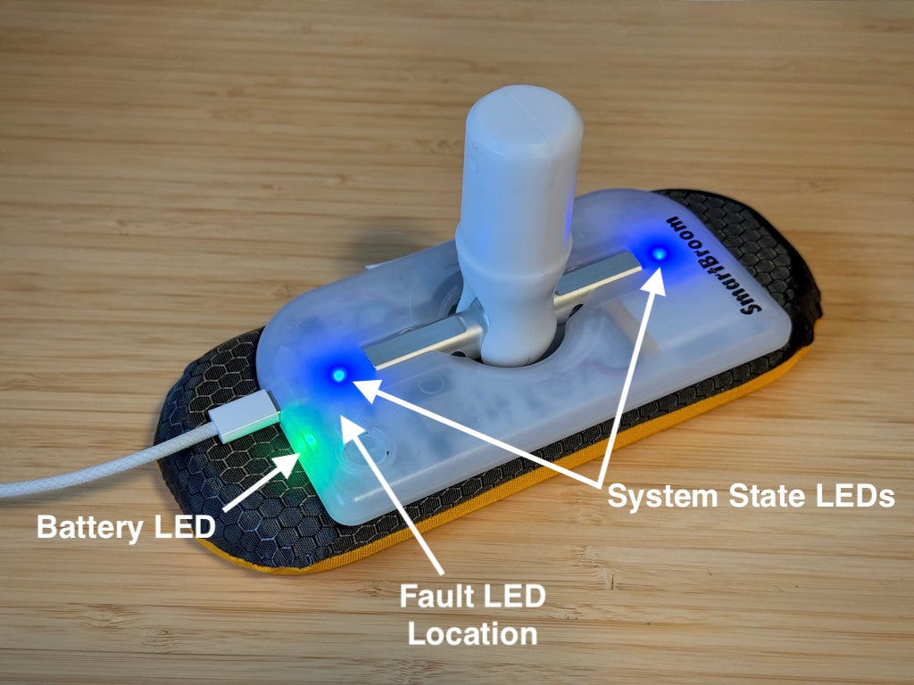

# LED Indication

SmartBroom 4 has four LEDs beneath its translucent housing. Read both the colour and the pattern to understand its state.

## Where to look

- **System state:** two LEDs, one on each side of the main load bar.
- **Battery and charging:** one LED beside the USB port.
- **Fault:** one LED near the top of the button.

## Is it ready to record?

With the broom **disconnected**, two solid blue system-state LEDs mean it is ready to save background sweeping data locally. Check for this before putting the phone away.

| System-state LED pattern | Meaning and next step |
| --- | --- |
| Both solid blue while disconnected | Ready for background recording. |
| Alternating dim and bright white while disconnected | Not ready to save locally. Connect and check ownership and device status. |
| Alternating white and purple | A bonded broom needs its clock set or storage freed. Connect to sync the clock and download stored data. |
| Opposing blue/purple blend | Bluetooth connected, without live sweep broadcasting. This indicates the connection; it does not by itself confirm recording readiness. |
| Flashing blue | Live sweep broadcasting to the app. |
| Rapidly alternating blue and purple | Saved data is being transferred. |
| Rapidly flashing blue | Raw live data transfer. |

See [Background Recording](background-recording.md) for preparation and downloads, and [Live Sweeping](using-smartbroom.md) for live sessions.

## Battery LED

The battery LED shows charge briefly at startup and charging progress while USB power is connected. See [Charging](charging.md) for the colours, thresholds, and low-battery warning.

## Fault LED

The fault LED is normally off. If it repeats a white-and-red flash code, [contact Curling Tools](../contact.md) and report the pattern. The number of flashes helps identify the fault.
